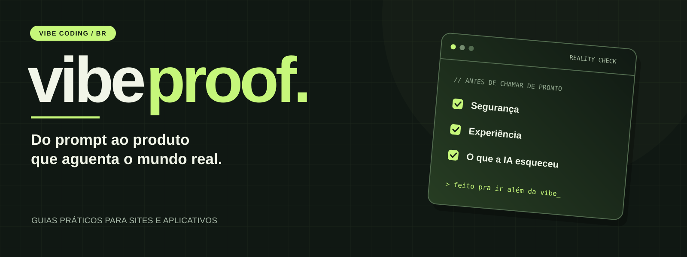

<p align="center">
  
</p>

<p align="center">
  <strong>Seu projeto funciona. Agora vamos cuidar do que falta para ele funcionar bem de verdade.</strong>
</p>

Você criou um site ou aplicativo com ajuda de IA e ficou animado com o resultado. Mas e se o formulário falhar? Se alguém acessar dados de outra conta? Se o projeto abrir quebrado no celular ou os anúncios não registrarem nenhuma conversão?

O **Vibeproof** reúne guias práticos para descobrir, executar e verificar essas partes que costumam ficar para depois. Cada guia funciona sozinho: use apenas o que faz sentido para a tarefa de hoje.

<p align="center">
  <a href="#escolha-um-guia"><strong>Explorar os guias</strong></a> ·
  <a href="#como-usar-com-ia">Usar com IA</a> ·
  <a href="CONTRIBUTING.md">Contribuir</a> ·
  <a href="LICENSE">Licença CC BY 4.0</a>
</p>

## Escolha um guia

### Produto e experiência

- [Formulários, captação e recuperação de acesso](guias/Formul%C3%A1rios%2C%20capta%C3%A7%C3%A3o%20e%20recupera%C3%A7%C3%A3o%20de%20acesso.md) — campos, erros, cadastro, login e senhas.
- [Responsividade, identidade e QA visual](guias/Responsividade%2C%20identidade%20e%20QA%20visual.md) — telas, dispositivos e acabamento.
- [Navegação, estados e interações](guias/Navega%C3%A7%C3%A3o%2C%20estados%20e%20intera%C3%A7%C3%B5es.md) — menus, modais, listas e estados de erro.
- [Acessibilidade](guias/Acessibilidade.md) — teclado, contraste, leitura e uso inclusivo.

### Confiança e operação

- [Segurança, backup e manutenção](guias/Seguran%C3%A7a%2C%20backup%20e%20manuten%C3%A7%C3%A3o.md) — acessos, dados, segredos e recuperação.
- [LGPD, privacidade e cookies](guias/LGPD%2C%20privacidade%20e%20cookies.md) — dados, escolhas e ferramentas de terceiros.
- [Performance e Core Web Vitals](guias/Performance%20e%20Core%20Web%20Vitals.md) — velocidade, estabilidade e interação.
- [Integrações e automações](guias/Integra%C3%A7%C3%B5es%20e%20automa%C3%A7%C3%B5es.md) — fluxos entre serviços e tratamento de falhas.
- [Domínio, DNS, HTTPS e publicação](guias/Dom%C3%ADnio%2C%20DNS%2C%20HTTPS%20e%20publica%C3%A7%C3%A3o.md) — endereço, certificados e redirecionamentos.
- [Finalização, produção e acompanhamento](guias/Finaliza%C3%A7%C3%A3o%2C%20produ%C3%A7%C3%A3o%20e%20acompanhamento.md) — entrega e verificação do projeto completo.

### Descoberta e crescimento

- [Analytics: GA4, GTM, Clarity e Search Console](guias/Analytics%20-%20GA4%2C%20GTM%2C%20Clarity%20e%20Search%20Console.md) — entender o que acontece no projeto.
- [Mídia paga: Meta Ads, Google Ads e UTMs](guias/M%C3%ADdia%20paga%20-%20Meta%20Ads%2C%20Google%20Ads%20e%20UTMs.md) — rastrear campanhas e conversões.
- [SEO técnico, indexação e dados estruturados](guias/SEO%20t%C3%A9cnico%2C%20indexa%C3%A7%C3%A3o%20e%20dados%20estruturados.md) — ajudar mecanismos de busca a encontrar e entender páginas.
- [SEO, AEO e GEO: pesquisa e oportunidades](guias/SEO%2C%20AEO%20e%20GEO%20-%20pesquisa%20e%20oportunidades.md) — descobrir o que o público procura.
- [SEO, AEO e GEO: conteúdo e páginas](guias/SEO%2C%20AEO%20e%20GEO%20-%20conte%C3%BAdo%20e%20p%C3%A1ginas.md) — criar respostas e páginas úteis.
- [SEO e GEO: autoridade e distribuição](guias/SEO%20e%20GEO%20-%20autoridade%20e%20distribui%C3%A7%C3%A3o.md) — presença em fontes relevantes.
- [GEO: medir presença em respostas de IA](guias/GEO%20-%20medir%20presen%C3%A7a%20em%20respostas%20de%20IA.md) — investigar menções e fontes citadas.

[Ver o índice completo e as referências →](guias/_%C3%8Dndice.md)

## Como usar com IA

Abra o guia que corresponde à sua tarefa e forneça o arquivo ao agente que está trabalhando no projeto. Você pode começar assim:

```text
Use o guia anexado para revisar [parte do projeto].

Primeiro entenda o funcionamento atual e identifique o que se aplica.
Depois, mostre os problemas encontrados e implemente as correções dentro do escopo que combinarmos. Teste o resultado e informe o que foi verificado, o que não se aplica e o que ficou pendente.
```

Quer implementar algo novo? Troque “revisar” por “implementar”, descreva o objetivo e informe o ambiente autorizado. Para acompanhar o trabalho, copie o guia para o seu projeto e marque os itens conforme forem verificados.

> Os guias são pontos de partida, não uma receita universal. Adapte-os ao projeto e confira as fontes atuais: ferramentas, práticas e requisitos podem mudar. Não coloque senhas, chaves ou dados pessoais nos registros.

## Contribua

Encontrou algo desatualizado, confuso ou faltando? Uma issue ou um pull request pode ajudar todo mundo. Veja [como contribuir](CONTRIBUTING.md). Se o Vibeproof te ajudou, deixe uma estrela para apoiar o projeto e encontrá-lo novamente. ⭐

## Licença e fontes

O conteúdo original está sob a [Creative Commons Atribuição 4.0 Internacional (CC BY 4.0)](LICENSE). Você pode compartilhar e adaptar, inclusive comercialmente, com atribuição e indicação de alterações. Marcas e materiais de terceiros citados ou vinculados pertencem aos respectivos titulares e não são licenciados por este repositório.

Os guias incluem referências e datas de revisão. Para mudanças relevantes, prefira fontes oficiais e registre quando uma recomendação depende do contexto.
